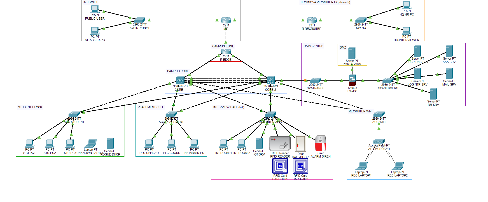

# PlaceGuard – A Zero-Trust, Self-Defending Network for Campus Placement Drives

Computer Networks (21CSC302J) case study, SRM Institute of Science and Technology, Kattankulathur – November 2026.

PlaceGuard is a two-site network built and tested in **Cisco Packet Tracer 9.0.1**. It protects the data of a university placement drive (resumes, student records, interview schedules, offer letters) shared between the campus, the placement cell, visiting recruiters and a company head office.

## What is in the network

43 devices across two sites: the SRM campus and "TechNova", a fictional recruiter HQ, linked over an ISP.

| Layer | Controls |
|---|---|
| Availability | HSRP v2 on two Catalyst 3560 cores, LACP EtherChannel, Rapid-PVST, dual-homed access switches |
| Management & audit | TACACS+ AAA with local fallback, SSH v2 only, VTY ACL, syslog and NTP |
| Transport encryption | Site-to-site IPsec VPN (IKE AES-256 / SHA / DH 5, ESP AES-256) |
| Perimeter | ASA 5506-X with CAMPUS / SERVERS / DMZ zones, IOS IPS (signature 2004), zone-based firewall at the HQ, NAT/PAT |
| Segmentation | 7 VLANs with role-based inbound ACLs on the core SVIs, native VLAN 999, unused ports parked in VLAN 998 |
| Layer-2 edge | Port security (sticky MAC, max 1), DHCP snooping, BPDU guard, PortFast |
| Physical / IoT | RFID-controlled interview hall: reader, smart door and siren on an isolated IoT VLAN |

| VLAN | Name | Subnet | Gateway (HSRP VIP) |
|---|---|---|---|
| 10 | Students | 10.10.10.0/24 | 10.10.10.1 |
| 20 | Placement | 10.10.20.0/24 | 10.10.20.1 |
| 30 | Interview | 10.10.30.0/24 | 10.10.30.1 |
| 40 | Recruiter Wi-Fi | 10.10.40.0/24 | 10.10.40.1 |
| 60 | IoT | 10.10.60.0/24 | 10.10.60.1 |
| 99 | Management | 10.10.99.0/24 | 10.10.99.1 |
| 100 | FW transit | 10.10.100.0/29 | 10.10.100.1 |

## Test results – 11 / 11 passed

| ID | Scenario | Result (real Packet Tracer output) |
|---|---|---|
| T1 | Legitimate student access | `placement.srm.edu` → 172.16.70.10, portal loads |
| T2 | Student reads the confidential DB | 4/4 timed out; ASA deny hit count 405 → 436 |
| T3 | Recruiter Wi-Fi → student VLAN | Destination host unreachable; interview room still reachable |
| T4 | Rogue DHCP server | Client still gets 10.10.10.103 / GW 10.10.10.1 from the real server |
| T5 | Unknown device on a port | Fa0/1 err-disabled, violation count 1 |
| T6 | ICMP flood from the Internet | Dropped; `%IPS-4-SIGNATURE: Sig:2004 [45.10.20.66 -> 203.0.113.5]` |
| T7 | Recruiter traffic interception | Mail delivered over IPsec; QM_IDLE, esp-aes 256, encaps/decaps rising |
| T8 | Core switch failure | CORE-1 powered off: 5 of 40 pings lost, CORE-2 Active for all 7 groups |
| B1 | Smart interview hall | Card 1001: door unlocks; card 2002: door locked, siren on |
| B2 | Zero-trust management | Student SSH times out; admin logs in through TACACS+ |
| B3 | Recruiter privacy (ZBF) | Campus cannot open sessions into the HQ LAN |

Screenshots for every test are in [`screenshots/`](screenshots), and the raw CLI output is in [`test-outputs/`](test-outputs). Problems found during testing and how they were fixed are in [`packet-tracer/BUILD_LOG.md`](packet-tracer/BUILD_LOG.md).

## Repository layout

| Folder | Contents |
|---|---|
| [`packet-tracer/`](packet-tracer) | `PlaceGuard.pkt`, build and demo guide, build log |
| [`configs/`](configs) | Final CLI configuration of every device, addressing plan, server GUI settings, portal pages |
| [`test-outputs/`](test-outputs) | Console output captured for each test |
| [`screenshots/`](screenshots) | Packet Tracer screenshots (topology, T1–T8, B1–B3) |
| [`diagrams/`](diagrams) | Report diagrams |
| [`docs/`](docs) | Case study report and presentation (PDF) |
| [`scripts/`](scripts) | Python scripts used to generate the report diagrams and assemble the report |

## How to open

1. Install Cisco Packet Tracer 9.0.1 or later. It's free from Cisco Networking Academy.
2. Open `packet-tracer/PlaceGuard.pkt`.
3. Follow the demo script in [`packet-tracer/BUILD_AND_DEMO_GUIDE.md`](packet-tracer/BUILD_AND_DEMO_GUIDE.md).

> **Lab-only credentials.** The configs contain passwords and keys, such as enable secrets, the TACACS+ key and the VPN pre-shared key. They exist only inside this simulation. Never reuse them on real equipment.

## Team

P. Nirik Reddy · Fayas · Venkatanathan O R V · Vishavjeet Bawa · Sana Ishwarya

B.Tech CSE (AI & ML), Department of Computational Intelligence, SRMIST. Guided by Dr. Poorvadevi R.
